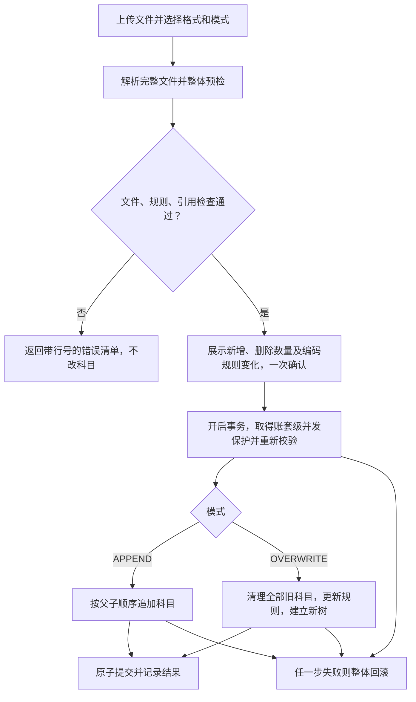

# 科目表导入改进计划：增量追加与空账套全量重构

> 2026-10-16 修订。本文是实施计划，不代表功能已实现。现状判断来自当前工作区静态代码核查；未完成真实迁移样本的端到端验证。

## 1. 背景、事实与范围

金蝶迁移需要在目标账套保留源科目编码及层级，使期初余额和历史凭证能够准确关联科目。在用账套补充科目与空账套迁移的约束不同，因此提供 APPEND 和 OVERWRITE 两种模式。

### 1.1 已核实的现状

| 问题 | 核查结论与证据 |
| --- | --- |
| 同码科目无法跳过 | `AccountExchangeService.validateOverwriteRules` 要求同码行必须 UPDATE；已有业务引用的科目又禁止覆盖，造成特定输入下的业务规则冲突，并非数据库死锁。 |
| 空账套模板无法通过普通删除接口清理 | `DefaultLedgerService.deleteAccount` 禁止删除模板和非叶子科目，与账套是否有业务无关。 |
| MAP 未形成下游编码转换闭环 | `AccountExchangeService.commit` 的 MAP/SKIP 分支不修改主数据。导入记录中的目标科目不等同于供期初、凭证导入使用的映射契约；不能据此认定已经发生串账，需样本验证。 |
| 页面缺少批量确认 | `AccountsTab.tsx` 每页 20 条，全部行确认后才能提交；后端已有 `decideAll`，并非完全没有批量能力。 |
| 解析与编码规则限制 | 已有金蝶原生四列及九列解析。`AccountCodeRule` 固定一级 4 位、最多 4 层，同一层级采用统一级长；自动推断仍须服从这些限制。 |

主要代码入口：

- `src/main/java/com/example/accounting/ledger/AccountExchangeService.java`
- `src/main/java/com/example/accounting/ledger/AccountCodeRule.java`
- `src/main/java/com/example/accounting/ledger/internal/application/DefaultLedgerService.java`
- `src/main/java/com/example/accounting/ledger/internal/persistence/AccountManagementRepository.java`
- `frontend/src/pages/AccountsTab.tsx`

### 1.2 本次目标与非目标

目标：取消常规导入的逐行决策；保留整体预检与一次确认；在明确支持的文件和编码范围内，安全实现新增或完整替换科目树。

非目标：清除已有账务、自动迁移业务引用、支持任意金蝶版本及任意编码体系、建立跨系统 MAP 转换平台。存在业务引用的废弃账套也不能直接重构，应新建账套。AI 建议不参与新模式的提交决策。

## 2. 总体流程

预检允许收集多个错误供用户一次修正；“快速失败”表示存在任何阻断错误就不写入主数据，不要求只返回第一个错误。预检产生的导入记录可以保存，但不得改变科目、编码规则或账务。

## 3. 双模式业务规则

### 3.1 APPEND：严格增量追加

适用于在用账套和空账套，只新增科目，不修改现有科目属性或账套编码规则。新增子级会自然改变父级的叶子状态，须通过既有业务约束。

提交前必须检查：

1. 文件内编码唯一；任何编码与现有科目重复均整体拒绝，不自动覆盖或跳过。
2. 同父级同名冲突同时检查文件内部和现有科目；根级名称冲突也需检查。名称归一化遵循统一规则，不在导入链路另设口径。
3. 父级可来自现有科目或本次文件；按完整集合校验，不能因文件中父级排在后面而误报缺失。
4. 校验父级存在、层级与编码匹配、无环，以及类别、余额方向、名称、状态和核算控制字段。
5. 不允许已有业务引用的叶子科目变为父科目；遵循现有创建子科目的约束。
6. 所有行通过后按层级顺序创建；任何一行失败整批回滚。

重复上传同一文件仍会出现重复编码错误；同一已提交导入任务的网络重试则返回原结果，不能重复执行。

### 3.2 OVERWRITE：仅限可安全重构的空账套

这里的“全量”指替换账套内全部旧科目，包括模板与自建科目，不能仅删除无引用部分并保留残余旧树。

以下任一条件成立均阻断：

- 存在任何状态的凭证，包括草稿；不能仅统计已记账凭证。
- 存在任何期初记录，包括未确认或金额为零的记录。
- 存在余额投影、发生额等需要保留的账务依赖或异常残留，具体查询清单须在实施前完成。
- 存在固定资产类别、固定资产卡片等外部业务或配置对科目的引用。
- 发现尚未定义处理方式的引用，或无法证明可安全删除。

`has_business_usage` 当前仅涵盖凭证分录与期初引用，不是完整的清空许可。实施前须逐项盘点数据库外键及按编码关联的配置，并形成“依赖表/字段、检查方式、处理策略”清单。

处理原则：

- 业务数据和外部配置引用：明确返回阻断原因，不自动删除、置空或重绑。
- 仅属于科目自身的从属配置：明确列入允许清理清单后，与旧科目一并在事务内清理；确认不会通过级联删除扩散至业务数据。
- 历史导入记录：保留审计信息；对其中指向旧科目的预检任务做失效检查，避免旧任务在重构后继续提交。
- 科目父子关系：按从属依赖顺序处理，删除完成后必须验证旧科目无残留。

使用专用内部重构方法，不放宽普通 `deleteAccount` 的模板删除限制，也不开放独立的无保护“清空科目”接口。

### 3.3 编码规则推断与支持范围

1. APPEND 严格使用现有账套规则；OVERWRITE 可以在提交事务中修改规则。
2. 首期保持现有模型：纯数字编码、一级 4 位、最多 4 层、每层统一级长，并满足 `AccountCodeRule` 的宽度及总长度限制。
3. 结合完整编码集合、显式父级信息及层级关系推断，不能只统计长度分布。保留前导零，禁止通过数值转换悄悄改码。
4. 候选规则必须对所有科目和父子关系成立；缺失父级、混合级长、超层级或无法无损解析时阻断，不自动补造科目或改码。
5. 多个规则均成立时要求用户明确选择；文件未出现的后续层级不能声称已经推断，可给出标明来源的默认值供确认。
6. 预检展示完整规则对象及其来源；例如仅观察到三级科目时，仍需明确第四层级长。不能只返回含义不完整的 `4-3-3` 字符串。

## 4. 事务、并发与重试

### 4.1 原子执行边界

文件解析和不依赖账套状态的校验先完成；提交时在一个事务内执行权限与状态复核、引用检查、清理、规则更新、建树、成功状态写入。任何失败必须回滚全部科目和规则变更。

提交绑定保存的文件内容或摘要、格式、模式、规则选择以及预检版本，不能让预检后更换参数而继续使用旧确认结果。账套状态或科目变化后返回预检失效，要求重新预检。

### 4.2 并发保护

仅使用 `@Transactional` 不足以排除“检查后新增引用”的竞态。实施前必须明确统一锁协议及参与入口：

- 同一账套的重构、科目增删改、编码规则修改须互斥。
- 凭证、期初、固定资产配置等新增或修改科目引用的入口必须参与相同的保护协议，或使用经验证等效的数据库方案。
- 可采用账套行锁或事务级 advisory lock，但只在导入入口加锁不算完成。
- 统一锁顺序，并明确等待超时与冲突响应；数据库外键继续作为最后防线。
- 用双会话验证：重构与新增引用并发时，只允许一个按既定顺序成功，另一个等待后重新校验或明确失败，不出现孤立引用或半棵树。

### 4.3 幂等与审计

同一 importId 只执行一次。重复提交或超时重试返回已提交结果；并发提交不能执行两次。保存操作者、账套、模式、文件摘要、规则变化、删除/新增数量及完成状态；失败信息应可追溯，但不能把已回滚操作标记为成功。

## 5. 模块与接口调整

### 5.1 服务及仓储

- `AccountExchangeService` 增加 ImportMode，分离完整预检与提交执行，复用现有文件解析及字段校验。
- 为 APPEND、OVERWRITE 使用确定性执行计划，不再依赖逐行 CREATE/UPDATE/MAP/SKIP 决策。
- 为仓储增加完整的重构资格检查、专用全量删除和规则更新能力；方法名应明确“整套替换”，避免 `clearUnusedAccounts` 暗示允许部分清理。
- 复用现有创建约束，但核查导入顺序、模板身份、标准科目标识、辅助核算、现金流和数量核算字段的处理。不能因重建丢失必要语义。
- 四列文件无法表达的核算配置应列出缺失项和明确默认值；对会影响后续入账的缺项阻断或要求补充，不宣称与源系统全字段等价。

### 5.2 API 与兼容性

保留“上传预检 → 一次确认提交”的两步交互：

- `POST /v1/ledgers/{ledgerId}/account-imports`：接收 file、format、mode，以及可选编码规则，创建预检任务。
- `POST /v1/ledgers/{ledgerId}/account-imports/{importId}:commit`：提交已确认的任务，并校验预检版本。

预检响应包含模式、格式、文件摘要、总行数、新增数、待删除数、旧/新完整编码规则、规则来源、警告和阻断原因。错误须包含行号、科目编码及可操作说明；账套级引用错误包含引用类型。

提交响应包含任务状态、实际新增/删除数量和最终规则，不把预检成功当作导入成功。

兼容性要求：

- 盘点前端、MCP、OpenAPI 生成客户端及测试对旧接口和 `decideAll` 的调用。
- 不把旧“上传仅预检”的接口静默改成上传即删除或提交。
- 旧客户端未传 mode 时保持原契约或明确拒绝并提示升级，禁止默认全量重构；发布前确定并记录唯一策略。
- 迁移完成前保留必要的旧端点；明确旧预检任务的兼容/失效规则后再移除旧决策与 AI 路径。
- 同步 OpenAPI、生成类型和 MCP 工具说明。

### 5.3 前端

- 文件与格式选择后显式选择模式；可以提示适用场景，但不能隐式选择破坏性操作。
- 使用后端资格检查展示 OVERWRITE 是否可用，并显示凭证、期初、配置引用等具体原因；前端置灰不能替代提交时检查。
- 保留整体预检摘要和可筛选的错误明细；分页可以保留用于浏览，不再要求逐行确认。
- 确认重构时清楚显示“删除全部旧科目 X 个、新建 Y 个”及编码规则变化。
- 一次确认后提交，成功刷新科目树；失败保留错误和任务状态，便于修正或安全重试。

## 6. 实施顺序与验收

| 阶段 | 交付内容 | 进入下一阶段的条件 |
| --- | --- | --- |
| 1. 依赖与契约盘点 | 引用清单、统一锁协议、旧客户端兼容策略、支持的文件样本与字段范围 | 不存在处理策略未定义的删除依赖；所有引用写入口已列明 |
| 2. 解析与整体预检 | 复用四列/九列解析；补充规则推断、模式校验与摘要 | 有效样本与所有负例均返回可解释结果，预检不改主数据 |
| 3. 原子提交 | APPEND、专用 OVERWRITE、幂等与审计 | 回滚、并发和跨账套隔离验证通过 |
| 4. 接口与前端 | 整体预检、一次确认、状态提示、客户端同步 | 无逐行确认要求，旧客户端不会触发意外重构 |
| 5. 迁移回归 | 科目、期初、凭证及必要配置的代表性样本 | 编码、归属、金额、辅助维度逐项核对一致 |

### 6.1 必须覆盖的验证场景

| 范围 | 核心场景与预期 |
| --- | --- |
| APPEND | 文件内重复、与现有重复、同父同名、父级后出现、缺失父级、已使用叶子新增子级；任一非法行导致整批不写入 |
| OVERWRITE 资格 | 仅模板或无引用自建科目可重构；草稿/正式凭证、未确认/已确认/零金额期初、固定资产配置引用均阻断 |
| 全量一致性 | 成功后编码集合与导入集合一致，无旧树残留；其他账套不变 |
| 编码规则 | 支持范围内的 4-2-2、4-3-3 样本；前导零、歧义、缺层、混合级长、超四层负例；未观察层级明确确认 |
| 回滚 | 在删除后、规则更新后、创建中途模拟失败，原科目及规则完整恢复 |
| 并发与幂等 | 同任务重复提交、两个导入并发、重构与新增凭证/期初/配置引用并发、预检后科目变化 |
| 文件与字段 | 四列、九列、STANDARD，以及实际支持的 xls/xlsx 样本；损坏文件、字段缺失、核算配置无法表达时明确失败或提示 |
| 下游数据 | 按源编码核对科目归属、期初借贷金额、凭证分录借贷金额、辅助维度及余额，不以“接口成功”代替正确性 |
| 权限与兼容 | 无写权限不可提交、跨账套任务不可访问、旧客户端及旧预检任务符合约定 |

验证遵循项目约定：优先使用独立测试数据库和 HTTP 验证；已有后端通过编译及 devtools 应用变更，不为小改动重复启动测试上下文。事务回滚和并发等 HTTP 难以充分验证的场景采用聚焦集成测试。前端仅运行相关测试，仓库级检查须另获当前任务授权。破坏性样本与故障注入不得使用正常业务账套。

期初和历史凭证的验证必须约定迁移截止日期及覆盖期间，避免期初已包含历史发生额又重复导入凭证造成余额重复。

## 7. 成功标准与收益

- 在约定的受支持样本集内，全部预期成功案例导入成功，全部非法或不安全案例被阻断。
- 全量重构没有残留旧科目；任一失败不会造成部分删除、部分新增或规则单独变化。
- 用户完成文件、模式与必要规则选择后，只需一次整体确认，无需逐行操作。
- 下游样本的编码、科目归属、金额和辅助核算核对一致；不承诺任意金蝶数据均可无修改导入。
- 简化人工决策流程，复用已有解析、批量和事务能力；不预先承诺代码减少比例或未经测量的成功率、性能指标。

发布前以真实脱敏样本记录行数、耗时、失败原因及核对结果，作为后续扩展格式和优化性能的依据。
